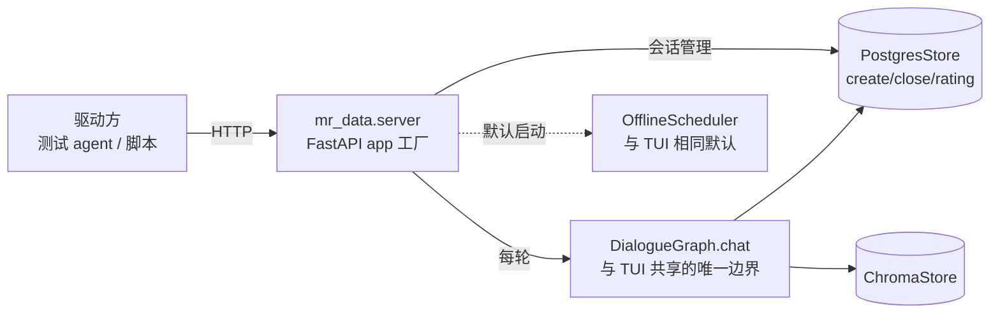

# Chat HTTP 交互 API

> 状态：**已实施（改进 92，2026-11-17）**。契约结论已回填：事件回调契约见 [design/online-pipeline.md](design/online-pipeline.md#8)，端点/错误码/事件形状仍以本文 §3 为准；00-index 路由已同步。
> 一句话目标：为对话管道加一个本地 HTTP 交互层，让外部 agent（含测试 agent）能通过 REST 驱动完整对话生命周期（建会话 → 逐轮对话 → 关会话），并拿到每轮的结构化中间事件——实现「agent 测试 agent」：测试 agent 扮演用户，对被测系统做端到端驱动与断言。
> 前置阅读：[doc/design/overview.md](design/overview.md#3)（降级总原则）、[doc/design/online-pipeline.md](design/online-pipeline.md#7)（降级链）、[doc/testing-guidelines.md](testing-guidelines.md)。本文是在线对话的 HTTP 交互契约（端点/错误码/事件形状）；管道内部机制见 design/。
> 修订记录：v1 初稿；v1.1 按用户要求增设「与 chat TUI 的兼容」专节——**不做抽取公共装配函数的重构，server 侧自建兼容层，cli.py 现有行为逐字不变**；v1.2 应用户问询在 §3 显式写明 message 端点的逐轮语义（单轮输入、服务端历史衔接、驱动方无状态）；v1.3 **端点改名单数 `/message`（一次调用=一轮=一条用户消息）**，§3 扩写为逐端点完整契约（错误码全集表 + 每端点请求字段表/响应全例/执行序），消除「messages 复数 vs 单轮语义」等歧义；v1.4 **应用户意见把装配逻辑提升为通用层**（新增 `mr_data/runtime.py` 装配模块、cli.chat 改为薄适配壳）——graph.py 管对话、runtime.py 管运行环境装配，TUI 与 HTTP 同为薄壳，消除原「装配序列双写」风险；TUI 行为不变由 §8.1 行为清单 + 回归测试守住；v1.5 应用户追问把「行为保持风险」落实为 **§8.3 装配边界裁决**（启动告警经 `Runtime.startup_warnings` 接驳，TUI 逐字 rprint / server 记日志）——重构的非机械点全部钉死，原风险条从 §11 移除；v1.6 用户在文档内直接裁决 Q-5（默认端口 **8080**）与 Q-6（**v1 即加 `POST /offline`**，同步等待完成，为 agent 测试提供确定性的归因后断言点）——两裁决归档 decisions.md D-91/D-92，§11 随未决清零而移除；v1.7 **实施完成（改进 92）**：`mr_data/runtime.py` 装配层 + cli.chat 薄壳重构（TUI 行为由既有测试守护，零改动）、`mr_data/server/`（app 工厂 + uvicorn 入口）、`graph.chat(on_event=...)` 事件 tap（实现取「invoke 期间挂临时 logging handler 旁路」，不改任何节点代码）、`mr-data serve` 子命令、config 新增 `server_host`/`server_port`。两处文档随实施对齐：① §8.3 裁决微调——调度器初始化失败告警**不进 `startup_warnings`**（原 cli 对此只记日志不 rprint，为守 §8.1「TUI 可见行为逐字不变」；server 侧可经 `offline.schedule_init_failed` 结构化日志事件获取同一信息）；② §5「关会话后归因」段补上 D-92 已引入的同步 `POST /offline` 触发点（原句「v1 不为 HTTP 增加同步归因等待」与 D-92 矛盾，按裁决修正）。

## 文档地图

- §1 目标与范围：做什么、明确不做什么。
- §2 总体架构：模块划分与装配方式。
- §3 API 契约：端点表与请求/响应形状。
- §4 可观测性：每轮事件列表的通道设计（含方案裁决）。
- §5 HTTP 语义与降级链映射：什么算成功、什么算失败。
- §6 并发与资源生命周期：共享单例的线程姿态。
- §7 配置与入口：新配置键与启动方式。
- §8 与 chat TUI 的兼容：TUI 行为清单与 TUI/HTTP 薄壳划分。

## 1. 目标与范围

**做**：

- 新增 `mr_data.server` 模块，对外提供 REST API：创建会话、逐轮发消息（拿回复 + 本轮结构化事件）、查询会话、关会话（可带评分）。关会话语义与 TUI 一致：会话进入离线归因候选。
- 应用工厂支持依赖注入：测试/agent 场景可注入 `FakeLLMClient`、假 store 等；默认场景按现有默认值装配共享单例，与 CLI chat 同一套默认行为。
- 每轮响应携带本轮结构化事件列表（见 §4），使驱动方无需解析日志文件即可断言「本轮走了哪条降级路径、检索命中了什么」。

**不做**（v1 明确排除）：

- **SSE/流式输出**：`DialogueGraph.chat()` 是整轮同步返回，v1 直接整轮返回。流式留待有真实需求时再做。
- **经 HTTP 暴露维度编辑模式**：`/dimension` 的 mini-REPL 语义（状态条、模式内命令集）不适合平铺成 REST，v1 不做；维度维护继续走 CLI `mr-data dimension`。
- **鉴权与多租户**：v1 是绑定 `127.0.0.1` 的本地工具，不暴露鉴权面。
- **改动 CLI chat 的现有行为**：TUI 的输入循环、slash 命令、评分流、调度器生命周期全部保持不变（§8）。
- **会话内并发**：同一时刻一个会话只被一方驱动（TUI 或 HTTP 二选一），不提供跨端仲裁。

## 2. 总体架构



三个结构决策：

1. **模块即新增，不动现有模块**。`mr_data.server` 下分 `app.py`（FastAPI 工厂与端点）与 `main.py`（uvicorn 启动入口）；唯一被触碰的现有文件是 config.py 增加两个配置键（§7）与 graph.py 增加一个可选参数（§4），均为向后兼容的纯增量。
2. **应用工厂 + 共享单例**：`create_app(graph=None, pg=None, start_scheduler=None)`。各参数为 None 时按现有默认值装配（等价于 cli.chat 的装配段）；非 None 时原样使用——测试经 TestClient 注入 `FakeLLMClient` 时零真实基建。装配出的 `DialogueGraph` 是进程级单例（内部已持有 pg pool/chroma/llm，连接按 dsn 进程级共享，天然适合复用）。
3. **通用装配层：`mr_data/runtime.py`，cli.chat 为薄适配壳**。装配逻辑（schema init/seed、离线归因引擎、调度器及其降级语义）收敛在 `build_runtime() -> Runtime`（Runtime 持有 graph/pg/offline_engine/scheduler 与 start/stop 生命周期）；server 与 TUI 共用这一个装配入口，杜绝双写漂移。cli.chat 只保留交互层职责（输入循环、slash 命令、评分询问、/newsession 线程），其可观察行为由 §8.1 行为清单钉住。graph.py 与 runtime.py 共同构成「TUI 与 HTTP 之下的通用层」：前者是通用对话引擎，后者是通用运行环境。

## 3. API 契约

### 3.1 通用约定

- Base URL：`http://127.0.0.1:<server_port>`（默认端口见 §7）。
- 请求/响应体均为 `application/json; charset=utf-8`。
- 时间字段为 ISO 8601 UTC 字符串。
- 路径参数 `{id}` 即会话 ID；服务端生成的 ID 为 UUID 字符串。
- **错误统一形状**：`{"error": {"code": "<机器可读标识>", "message": "<人类可读说明>"}}`。`code` 是稳定契约，驱动方可安全按值分支；`message` 仅供人读，不保证稳定。已定义的 `code` 全集：

| code | HTTP 状态 | 触发条件 |
|---|---|---|
| `session_not_found` | 404 | 路径中的会话 ID 不存在 |
| `session_already_exists` | 409 | 创建会话时指定的 ID 已存在 |
| `session_closed` | 409 | 向已关闭会话发消息 |
| `session_already_closed` | 409 | 重复关闭已关闭的会话 |
| `invalid_message` | 400 | 消息请求体缺 `content` 或 trim 后为空 |
| `invalid_rating` | 400 | 评分缺失/`score` 不在 {-2,-1,0,1,2} |
| `rating_failed` | 500 | 评分写入 PG 失败 |
| `chat_turn_failed` | 500 | `graph.chat()` 整轮异常 |
| `offline_busy` | 409 | 离线归因正在运行（进程内 `_RUN_LOCK` 或跨进程 advisory lock 被占） |
| `offline_failed` | 500 | 离线归因运行中途失败 |
| `internal_error` | 500 | 未预期的其他内部异常 |

### 3.2 端点总表

| 方法 | 路径 | 作用 | 成功 |
|---|---|---|---|
| POST | `/sessions` | 创建会话（可指定 ID） | 201 |
| GET | `/sessions/{id}` | 查询会话状态 | 200 |
| POST | `/sessions/{id}/message` | 发送一轮用户输入（单数 message：**一次调用 = 一轮 = 一条用户消息**） | 200 |
| POST | `/sessions/{id}/close` | 关会话（可带评分），进入离线归因候选 | 200 |
| POST | `/offline` | 手动触发一轮离线归因（同步等待完成） | 200 |
| GET | `/health` | 存活探针 | 200 |

### 3.3 POST /sessions — 创建会话

请求体**整体可省略**（空体 = 全部默认）：

| 字段 | 类型 | 必填 | 说明 |
|---|---|---|---|
| `session_id` | string | 否 | 指定会话 ID；省略则服务端生成 UUID |

规则：指定 ID 已存在 → **409 `session_already_exists`**，不做静默复用/重置（`create_session` 的 ON CONFLICT 重置语义是 TUI `--session-id` 的交互特权；对机器驱动方，显式错误优于隐式状态重置）。

**201 响应**：

```json
{"session_id": "f47ac10b-58cc-4372-a567-0e02b2c3d479", "status": "active"}
```

### 3.4 GET /sessions/{id} — 查询会话

**200 响应**（字段对应 `models.personality.Session`）：

```json
{
  "session_id": "f47ac10b-…",
  "status": "active",
  "rating": null,
  "rating_comment": null,
  "attribution_attempts": 0,
  "created_at": "2026-11-17T12:00:00+00:00",
  "closed_at": null
}
```

| 字段 | 类型 | 说明 |
|---|---|---|
| `session_id` | string | 会话 ID |
| `status` | string | `"active"` \| `"closed"` |
| `rating` | int \| null | 整体评分 -2..2，未评为 null |
| `rating_comment` | string \| null | 评分评论 |
| `attribution_attempts` | int | 离线归因失败累计（死信判定依据） |
| `created_at` / `closed_at` | string \| null | ISO 8601 UTC |

### 3.5 POST /sessions/{id}/message — 发送一轮

**逐轮语义（重要）**：每次调用在请求体里只放**本轮一条用户输入**，不含任何历史消息。历史连续性由服务端保证：`DialogueGraph.chat()` 每轮自行从 PG 读取最近 `dialogue_state_message_turns`（默认 10）轮历史（`PostgresStore.get_recent_dialogues`），且本轮经 `log_dialogue` 节点落库、下一轮即可读到——与 TUI 逐行输入的语义逐字一致（CLI 循环同样不在调用间维护历史）。因此驱动方是无状态的：创建会话后按序逐轮调用即可，多轮上下文由 server 自动衔接；这也意味着本端点**不可对同一会话乱序/并发调用**（与 §6「不做 per-session 锁」互为因果）。

请求体：

| 字段 | 类型 | 必填 | 说明 |
|---|---|---|---|
| `content` | string | 是 | 本轮用户输入；trim 后必须非空 |

查询参数：

| 参数 | 类型 | 默认 | 说明 |
|---|---|---|---|
| `include_events` | bool | false | 测试观测开关：true 时 200 响应才含 `events` 与 `log_level` 两字段；不传则响应不含这两键 |

错误：400 `invalid_message`；404 `session_not_found`；409 `session_closed`（向已关闭会话发消息会破坏离线归因的输入边界，显式拒绝）；500 `chat_turn_failed`（仅整轮异常，见 §5）。

**200 响应**（不带 `include_events`，默认形态）：

```json
{
  "session_id": "f47ac10b-…",
  "reply": "助手回复文本",
  "references": [{"id": "doc-id-or-record-id", "source_type": "line", "summary": "素材一句话总结"}]
}
```

带 `include_events=true` 时，响应额外含两键（示例仅为示意，非规范形状）：

```json
{
  "session_id": "f47ac10b-…",
  "reply": "助手回复文本",
  "references": [{"id": "doc-id-or-record-id", "source_type": "line", "summary": "素材一句话总结"}],
  "events": [
    {"event": "personality.loaded", "session_id": "f47ac10b-…", "details": {"dimensions_active": 3}},
    {"event": "think.decision_generated", "session_id": "f47ac10b-…", "details": {"inner_monologue": "…"}},
    {"event": "chat.reply_fallback", "session_id": "f47ac10b-…", "details": {"error": "…"}},
    {"event": "chat.turn", "session_id": "f47ac10b-…", "details": {"assistant_log_id": 42, "inner_monologue": "…", "personality_doc_count": 3, "memory_doc_count": 2, "web_doc_count": 0, "block_count": 1, "reference_count": 2}}
  ],
  "log_level": "info"
}
```

| 字段 | 类型 | 说明 |
|---|---|---|
| `reply` | string | 取自 `ChatResult.text` |
| `references` | array | 取自 `ChatResult.references`（全部块引用按 id 去重并集）；元素形状 = `ReplyReference`：`id`（素材唯一标识）/ `source_type`（line/event/evidence/web/dialogue）/ `summary`。HTTP 恒返回该字段，不受 CLI `--show-references` 开关影响 |
| `events` | array | **仅 `include_events=true` 时存在**。本轮会话带 `event` 标记的结构化日志行的按序镜像——事件源是各节点经 logger 打的记录，**按 logger 级别过滤**（常规事件 INFO 级、降级事件 WARNING 级，见 §4）。级别高于 INFO 时正常事件缺失是预期行为，不是故障。元素为 JSON 对象（`event`/`session_id`/`details`），**非规范形状，键可能随版本增删**——消费方（测试驱动方）按原始 JSON 读取即可，不要按固定 schema 编程 |
| `log_level` | string | **仅 `include_events=true` 时存在**。当前生效的 logger 级别（小写）；驱动方据此判断 events 可见范围——如为 `warning`，则 events 只含 WARNING 及以上事件 |

### 3.6 POST /sessions/{id}/close — 关会话

请求体**整体可省略**（省略 = 不带评分关闭，等价 TUI 回车跳过）：

| 字段 | 类型 | 必填 | 说明 |
|---|---|---|---|
| `rating` | object | 否 | 整体评分 |
| `rating.score` | int | `rating` 存在时必填 | 取值 {-2,-1,0,1,2} |
| `rating.comment` | string | 否 | 可选评论 |

错误：400 `invalid_rating`；404 `session_not_found`；409 `session_already_closed`（重复关闭显式报错，不做成幂等成功——幂等会掩盖驱动方的时序 bug）；500 `rating_failed`。

**执行序**：校验 → 写评分（若带）→ `close_session`。评分写入失败时**不执行关会话**、返回 500 `rating_failed`，驱动方可修正后重试——这是与 TUI 的有意差异：TUI 中评分询问失败仅记日志仍继续关闭（交互中用户已离开，关闭优先）；机器驱动下评分丢失应能被程序化发现并重试。**200 响应**：`{"session_id": "…", "status": "closed"}`。关闭成功即进入离线归因候选，响应**不等待**归因完成（§5）。

### 3.7 POST /offline — 手动触发一轮离线归因

请求体：无（空体）。

**同步语义**：端点在请求线程内执行 `guarded_offline_run(source="http")` 并**等待归因完成后才返回**——agent 测试需要在关会话后立即断言归因效果（维度计数变化、证据回写），异步触发会让断言出现竞态。真实 LLM 下整轮可能耗时数分钟，由调用方自行控制超时；agent 测试用 FakeLLM 时很快。

返回映射（`guarded_offline_run` 永不抛出，四态直映 HTTP）：

| 运行结果 | HTTP | 响应体 |
|---|---|---|
| `completed` | 200 | `{"status": "completed"}` |
| `busy`（进程内在跑）/ `locked`（跨进程锁被占，如 cron 触发中） | 409 | `{"error": {"code": "offline_busy", ...}}`（`message` 注明 busy/locked 原因） |
| `failed` | 500 | `{"error": {"code": "offline_failed", ...}}` |

护栏语义不变：与定时调度、手动 `mr-data offline`、/newsession 触发完全互斥（双层锁）；只是互斥触发源新增 HTTP 一个通道（日志事件以 `offline.http_*` 命名区分）。

### 3.8 GET /health — 存活探针

**200 响应**：`{"status": "ok"}`。仅表示进程存活（liveness）；不做 PG/Chroma 连通检查——避免健康检查自身引入慢依赖与抖动，连通性问题由具体端点的 500 暴露。

### 3.9 斜杠命令不映射为消息

`/exit` `/help` `/dimension` `/newsession` 是 TUI 循环的本地命令，不是对话输入，也不占用消息端点。HTTP 侧的对应能力都是一等端点（`/close` = 会话生命周期；维度编辑 = v1 不提供）。驱动方发给 `/message` 的纯文本一律进入对话管道——若用户真的输入了以 `/` 开头的文本（如告诉 Data「我喜欢 /help 这种命名」），它会被当作普通对话内容，与 TUI 行为一致。

## 4. 可观测性：每轮事件通道

「agent 测试 agent」的核心诉求是：驱动方要能断言**本轮实际走了哪条路径**（检索命中数、think 决策、降级节点、落库结果），而不只是收到一段回复文本。

候选方案：

- **方案 a（裁决采纳）**：给 `DialogueGraph.chat()` 增加可选参数——事件回调或 per-call 事件缓冲（如 `chat(session_id, user_input, on_event=None)`）；server 端每轮挂一个缓冲收集器，把列表放进响应。改动是向后兼容的纯增量：默认 None 时行为与今日完全一致，TUI 调用点零改动。
- 方案 b（否决）：驱动方 tail JSONL 日志文件自己解析。零改代码，但按 session_id 关联、按轮次切分都脆，且把「测试断言」耦合到日志格式——testing-guidelines.md 认定日志格式是易变面，不适合作测试契约。

事件项的形状直接复用 logging 的结构化 extra：`{event, session_id?, details}`（与 AGENTS.md 约定一致），server 原样透传、不做再加工。事件源是各节点已在打的结构化日志（`personality.loaded`、`think.decision_generated`、`retrieve.*`、降级类 `*.reply_fallback`、收尾 `chat.turn` 等），实现上是把这些事件在 invoke 期间旁路一份给回调，日志落盘路径不变。

事件可见性随 logger 级别（常规事件 INFO 级、降级事件 WARNING 级；级别由部署方配置，欲拿完整事件流的驱动方自行将级别配为 INFO）。HTTP 侧经 `include_events` 开关返回这两键（§3.5），普通调用零感知。

该契约（chat() 的可选回调参数与事件形状）已回填 [design/online-pipeline.md](design/online-pipeline.md#8)。

## 5. HTTP 语义与降级链映射

在线管道的总原则是「保守降级，绝不穿透到用户」（overview.md 原则 6）。HTTP 层照抄这个语义，不发明新的失败面：

- **节点级降级 ≠ HTTP 失败**。think 失败走静态兜底、检索失败留空、structured 降级纯文本——这些都返回 200，`events` 里带着对应的降级事件（`think.decision_failed`、`retrieve.personality_failed`、`chat.reply_fallback`……）。驱动方断言降级路径靠 `events`，不靠状态码。这与 testing-guidelines.md「测留下了什么」一致：断言最终行为 + 事件标记。
- **整轮失败 = 500**。仅当 `graph.chat()` 自身抛异常（`chat.error` 已记日志）时返回 500 `{"error": {"code": "chat_turn_failed", ...}}`，TUI 对应行为是打印错误并继续循环——HTTP 无循环可言，直接把失败交还驱动方决策。
- **会话管理失败区分 4xx/5xx**：会话不存在 404；评分取值越界 400（TUI 中非法评分是警告后跳过——HTTP 选择 400 拒绝而非静默跳过，因为机器驱动方应当能程序化地发现入参错误；这是刻意的语义差异，记录于此）；PG 故障 500。
- **关会话后的离线归因不在响应内等待**。关会话只负责置 closed（进入归因候选）；后台归因沿用现有调度/cron 与护栏机制（`guarded_offline_run`，advisory lock 互斥）。同步等待的归因触发由 `POST /offline` 提供（D-92，§3.7）——agent 测试在关会话后调用它即可获得确定性的归因后断言点。

## 6. 并发与资源生命周期

- **全链路同步**（psycopg pool、openai SDK、langgraph invoke 均同步阻塞）：FastAPI 的同步端点自动落线程池，无需 async 化。v1 不做 async 重构。
- **共享单例 DialogueGraph**：pg 连接池与 chroma client 线程安全；langgraph 的 `graph.invoke(state)` 每轮持有独立 `DialogueState`，单例复用在低并发 agent 驱动下可用。已知限制如实记录：`LLMClient` 的 OpenAI client 惰性初始化无锁，首个并发请求有竞态窗口——agent 测试场景并发度极低，接受为已知限制，不做修复（修了反而扩大改动面）。
- **进程生命周期**：uvicorn 启动时装配单例（schema init + seed 与 TUI 相同），随进程退出销毁；pg pool 本就不提供显式关闭（进程级按 dsn 共享），chroma/embedding 由对象持有随进程结束。OfflineScheduler 默认随 server 启动、关停随进程退出，与 TUI 的 `finally` 语义对应。
- **不做 per-session 锁**：§1 已排除跨端仲裁；同一 session 串行驱动是驱动方的责任（agent 测试天然串行）。

## 7. 配置与入口

- config.py 两键：`server_host`（默认 `127.0.0.1`）、`server_port`（默认 `8080`，用户裁决 Q-5；env 前缀沿用 `MR_DATA_`）。
- 启动方式：CLI 子命令 `mr-data serve`（`--host/--port` 可覆盖），内部调 `mr_data.server.main:serve()`；pyproject 不加第二个 script 入口，与现有单入口风格一致。
- 依赖：`fastapi`、`uvicorn` 为 pyproject 直接依赖（uvicorn 原为 chromadb 传递依赖）。

## 8. 与 chat TUI 的兼容

### 8.1 cli.chat（TUI）可观察行为清单

以下行为由 cli.chat 定义，是 TUI/HTTP 薄壳划分的准绳（§8.2）：

1. 启动装配序列与默认值：`DialogueGraph(enable_web_search=<flag>)` → `PostgresStore()` + `init_schema()` + `seed()` → `AttributionEngine` 复用 graph 的 store/llm → `OfflineScheduler`（cron 非法或初始化失败时降级为「不启用调度」，只告警不阻断）。
2. slash 命令集与分派：`/exit|/quit|/bye`、`/help|/?`、`/dimension`（进入维度编辑模式）、`/newsession`；非命令输入才进 `graph.chat()`。
3. 评分流：会话关闭前询问一次整体评分（-2..2 + 可选评论），空输入跳过；非法输入警告后跳过（`cli.session_rating_invalid` 事件）；评分询问失败只记日志，仍继续关会话。
4. `/newsession` 语义：评分 → close → create → 后台线程异步触发一轮离线归因（`guarded_offline_run`，与定时调度/手动 offline 互斥），退出时对在途归因线程 `join(timeout=5)`。
5. 退出清理序：停调度器 → join 归因线程 → 评分 → close_session（各步失败独立记日志、互不阻断）。
6. 启动选项：`--session-id`、`--web-search/--no-web-search`（默认 `settings.enable_web_search`）、`--show-references/--hide-references`（默认 `settings.show_references`）。

### 8.2 通用层与薄壳划分

- **共享边界**：TUI 与 HTTP 每轮对话都收敛到同一个 `DialogueGraph.chat()`；运行环境装配收敛到同一个 `mr_data/runtime.build_runtime()`。通用层之下无任何复制。
- **通用层构成**：`graph.py`（通用对话引擎）+ `runtime.py`（通用装配：`build_runtime() -> Runtime`，持有 graph/pg/offline_engine/scheduler 及 start/stop，内含调度器降级语义）。`runtime.py` 不承担任何交互职责。
- **cli.chat 薄适配壳**：chat 命令体 =「`runtime = build_runtime(...)` + 输入循环 + slash 命令 + 评分询问 + /newsession 线程 + `finally` 清理」，装配语句全部在通用层。会话级状态（`current_session_id` 游标、评分对话、后台归因线程）属于交互层，留在 cli.chat，不进通用层。
- **server 直接用通用层**：`create_app()` 默认路径调 `build_runtime()`；server 进程启动 = `Runtime.start()`，进程退出 = `Runtime.stop()`（lifespan 接驳，对应 TUI 的进入 `try` 之前与 `finally`）。会话级动作全部是一等端点：close 端点 = 评分 + close（对齐 §8.1 第 3 条），不在 server 侧保留「当前会话」隐式状态——HTTP 无状态，会话归属由路径参数显式给出（TUI 的隐式游标是交互循环的产物，HTTP 不模仿）。
- **评分语义差异已声明**：§5 中 HTTP 对非法评分返回 400，而 TUI 是警告后跳过——这是两处刻意差异之一（另一处是 HTTP 恒返回 references，不受 `--show-references` 影响），其余行为逐字对齐。

### 8.3 装配边界：组件归属与告警接驳

- **runtime.py 归属**：五个组件的构造与接线（`DialogueGraph`→`PostgresStore`+`init_schema()`+`seed()`→`AttributionEngine`→`OfflineScheduler`+`validate()`+`start()`/`stop()`）；调度器降级语义（cron 非法或初始化失败 → `scheduler=None`）。
- **cli.chat 归属**：输入循环、slash 命令分派、评分询问、`run_threads`（/newsession 后台归因线程的创建与 `join(timeout=5)`）、`current_session_id` 游标、`finally` 中「评分 → close_session」序。
- **启动告警接驳**：cron 非法的告警文案逐字存放在 `Runtime.startup_warnings: list[str]`（`build_runtime()` 填充）——TUI 侧 cli.chat 逐条 `rprint` 原样输出；server 侧同一列表以结构化日志事件记录（`server.startup_warning`），不打控制台。
- **一处刻意不对称**：调度器初始化失败（非 cron 非法）不进 `startup_warnings`——原 cli 对此只记日志、不 rprint，为守 §8.1「TUI 可见行为」不变而维持原样；server 侧可经 `offline.schedule_init_failed` 结构化日志事件获取同一信息。

