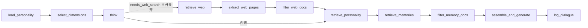

# online-pipeline：在线对话管道设计

> 本节定义在线管道的节点职责、状态契约、prompt 组装与降级链。改任何节点之前先查 #2 职责卡（改行为）与 #3 契约表（改状态）；新增节点必须同时登记两张表与 #7 降级链。
> 前置概念：记忆分类/id/分片见 [memory-and-retrieval.md](memory-and-retrieval.md)；归因如何消费本管道的产出见 [offline-attribution.md](offline-attribution.md)。
> 断言标注约定：`[记录]`=有 commit/文档证据；`[推断]`=从代码行为推断。

## 文档地图

1. 管道总览 — 节点清单与数据流
2. 节点职责卡 — 每节点的职责/输入输出/失败降级
3. DialogueState 契约表 — 每个 key 的语义、写入者、读取者
4. prompt 组装 — 分节优先级哲学与 token 预算
5. 引用与可解释性 — 引用即 URL、known_refs 对账
6. web 子管道 — 搜索→提取→过滤→沉淀
7. 降级链总表 — 每节点一行的降级方向与理由

## 1. 管道总览

**本节回答：一轮对话经过哪些节点、唯一的分支在哪。** 管道是线性图（无并行分支），11 个节点，唯一条件分支在 think 之后（是否走 web）： `[记录·改进 13/20/32]`

状态更新语义是**普通 overwrite**（无 reducer）：节点返回 `{**state, ...}`，后写覆盖先写。图为线性无并行，overwrite 足够；曾经有过的 reducer 因与覆盖语义冲突被删除。 `[记录·改进 32]`

## 2. 节点职责卡

**本节回答：每个节点做什么、吃什么状态、吐什么状态、失败怎么办。** 降级理由的汇总见 #7。

### load_personality
从 PG 加载固定身份、当前默认用户身份、全部活跃维度 → `identity` / `user_identity` / `dimensions`。每轮都重读，维度增减当轮生效。 `[记录]`

### select_dimensions
LLM 从活跃维度中选出本次应起作用的一个或多个 → `selected_dimension_ids`。**三态语义**：`[]` = 本轮无人格侧重（LLM 明确不选或调用失败），key 缺失才防御性回退全量——两种「空」不得混同，因为空选择会如实写入 `dialogue_dimension_refs` 供离线归因区分激活维度。幻觉 id 白名单过滤 + warning。 `[记录·改进 55/70]`

### think
单次结构化 LLM 调用，产出四路检索决策 + 内心独白 → `inner_monologue` / `personality_query` / `memory_query` / `needs_web_search` / `search_query`；`retrieval_query` = `memory_query`（历史遗留命名，日志沿用）。检索 query 由 LLM 语义改写而非用户原文。 `[记录·改进 20]` `[推断：fallback 决策 needs_web_search=False——think 失败时宁可不联网也不冒风险，搜索开关在节点内再强制一次]`

### retrieve_web / extract_web_pages / filter_web_docs
web 子管道三节点，整体受 `enable_web_search` 单一开关与 think 决策控制，内部细节见 #6。

### retrieve_personality
用语义 query 查 personality 集合（top_k 走配置）→ `personality_docs`。失败 → 空列表。 `[记录·改进 65]`

### retrieve_memories
用语义 query 查 memories 集合（top_k 走配置）→ `memory_docs`；命中统一 recall 计数 + state 内补丁（语义见 [memory-and-retrieval.md](memory-and-retrieval.md#4)）。 `[记录·改进 60/65/68]`

### filter_memory_docs
LLM 批量相关性过滤（开关 `enable_memory_relevance_filter`，**默认关**）。失败或全过滤为空 → 保留全部——宁可多给不可漏给。 `[记录·改进 24]`

### assemble_and_generate
管道核心：组装 prompt（#4）→ 结构化生成 → 引用对账（#5）。回复三级降级见 #7。 `[记录·改进 25/37/64]`

### log_dialogue
PG 事务写 4 步（user 日志、assistant 日志、维度 refs、vector refs），随后 PG 事务外逐片写 web 记忆（折中形态，见 D-81 与 offline-attribution#6）。 `[记录·改进 45/61/76]`

## 3. DialogueState 契约表

**本节回答：状态里每个 key 是什么意思、谁写谁读。** 语义改动必须同步离线归因的下游消费（`dialogue_dimension_refs` 等）。

| key | 语义 | 写入者 | 读取者 |
|---|---|---|---|
| `session_id` / `user_input` | 会话标识 / 本轮输入 | chat() 入口 | 全部节点 |
| `messages` | 最近 N 轮真实消息（默认 10 轮，含独白与引用块） | chat() 从 PG 加载 | assemble（历史窗口） |
| `identity` / `user_identity` | 固定身份 / 当前用户身份 | load_personality | assemble |
| `dimensions` | 全部活跃维度快照 | load_personality | select/think/assemble/log |
| `selected_dimension_ids` | **三态**：列表=本轮选中（可空），缺失=防御回退全量 | select_dimensions | think/assemble/log |
| `inner_monologue` | think 产出的内心独白 | think | assemble/log/落库 metadata |
| `personality_query` / `memory_query` | 两路检索的语义 query | think | 对应检索节点 |
| `needs_web_search` / `search_query` | 联网决策与搜索词 | think（开关内强制） | route/retrieve_web |
| `retrieval_query` | = memory_query 的别名，日志沿用 | think | 日志 |
| `web_docs` | web 子管道产出的 WebDoc 列表 | 三个 web 节点 | assemble/log（沉淀） |
| `personality_docs` / `memory_docs` | 两路检索结果（模型列表） | 对应检索/过滤节点 | assemble/log |
| `reply` / `reply_blocks` | 回复文本 / 内容块（含引用） | assemble | log、ChatResult |
| `assistant_log_id` | 落库返回的 assistant 行 id | log_dialogue | **无人读**——见 [open-questions.md](open-questions.md) |

## 4. prompt 组装

**本节回答：素材按什么优先级进上下文、超预算时谁先牺牲。** 设计原则 1「人格风格优先，事实依据其次」的量化就在这里：优先级数值即牺牲顺序。 `[记录·改进 48（修复动机即「违反人格优先」）]`

### 4.1 分节与优先级

| section | priority | role | 内容 |
|---|---|---|---|
| guidance | 100 | system | 素材使用规则（人格/记忆/近期对话/web 四条） |
| identity | 90 | system | 角色定义 + 用户身份 + 选中维度 + 内心独白 |
| format | 100 | system | 结构化输出要求（块+引用） |
| personality | 70 | assistant | `<personality>` XML 包裹的人格素材 |
| memory | 60 | assistant | `<memory>` 包裹的记忆素材 |
| web | 40 | assistant | `<web>` 包裹的网络资料 |

`priority ≥ 80` 为必保区；素材区按 人格 > 记忆 > web 排序——压缩先牺牲 web（事实），最后才动人格。 `[记录·改进 28/48]`

### 4.2 预算机制（两段）

1. **素材段压缩**（`fit_sections`）：总 token ≤ `llm_context_token_limit`（默认 30K）原文通过；超限时按 priority 降序**贪心注水**——同优先级整组装得下则原文保留，第一个装不下的组按体积分摊剩余预算并走 LLM 压缩（压缩失败硬截断），更低优先级组输出省略占位符（不空 section）。 `[记录·改进 48]` `[推断：等比分摊保留在「第一个装不下的组」内部，是体积公平与优先级严格的折中]`
2. **历史窗口拼装**（改进 74/77）：素材段成 `base` 后，剩余预算 = limit − Σbase − 本轮输入（**互不重叠**）；从最近一轮往前贪心装整轮（user/assistant 真实交替消息，渲染含独白与参考来源标注），装不下的最老整轮整体丢弃，记 `chat.history_trimmed`。本轮输入永远在最后一条 user 消息。 `[记录·改进 74/77]`

老历史（超出窗口的部分）不在线压缩成摘要——由情节记忆检索覆盖。 `[记录·改进 74 核实说明]`

### 4.3 角色分布哲学

context 材料从 system 拆到 assistant 消息（XML 标签分类），system 只留身份与使用规则——「角色设定是你是谁，素材是你参考什么」，分离后模型更少把素材当指令。 `[记录·改进 28]` `[推断：动机表述基于「system 首段明确指引 LLM 如何使用素材」的 commit 描述]`

## 5. 引用与可解释性

**本节回答：回复里的引用如何保证真实、可追溯。**

- 回复按块（block）组织，每块携带引用列表（id + source_type + 一句话总结）。 `[记录·改进 25]`
- **known_refs 对账**：assemble 时建立「本轮素材清单」——web 键 = `metadata.url`（空 url 不注册，防空键让任意空 id 命中），personality/memory 键 = doc.id → 值 = 系统侧 source_type。LLM 回传的引用 id 必须命中清单，否则丢弃。 `[记录·改进 78/79]`
- **source_type 以系统为准**：命中清单的引用，source_type 用清单值覆盖 LLM 填值；未命中的引用被丢弃，故 LLM 的 source_type 实际进不了结果——`ReplyReference.source_type` 保持自由 str 是有意（强校验会让小模型的不规范输出炸掉整个回复解析）。 `[记录·改进 39]`
- 追溯链：assistant 日志的 metadata.blocks 落库；`dialogue_vector_refs` 每 web 片一行登记（改进 76）。**已知语义错位（现状≠设计）**：vector_refs 记录的是「检索到的全部素材」而非「实际被引用的」，memory_docs 缺席该表——见 [open-questions.md](open-questions.md)。 `[记录·last_time_left #14]`

## 6. web 子管道

**本节回答：联网资料从搜索到沉淀的完整链路。** 三个节点作为整体被 think 决策 + `enable_web_search` 开关控制（改进 20）；`web_extract_max_pages` 之后的搜索结果不抓正文、以 snippet 级保留（改进 65）。

1. **搜索**：7 家 provider（DuckDuckGo/SearXNG/Brave/Bing/Google CSE/百度/360）按 `web_search_providers` 配置顺序调用，失败或无结果自动降级下一家；各家返回键差异归一化为 WebDoc。 `[记录·改进 23]`
2. **正文提取**（PageExtractor）：requests 单次抓取（跟随重定向，最终 URL 即真实 URL）→ trafilatura 主解析 → BeautifulSoup 兜底；无 charset 头站点用 apparent_encoding 修正防中文乱码；超 `web_extract_max_length` 截断。成功后 `metadata.url` 换真实 URL、原链接留 `source_url`——重定向链接（百度/360 跳转）由此归一。提取失败保留原 snippet 文档。 `[记录·改进 44/65/73]`
3. **相关性过滤**（`filter_web_docs`，开关 `enable_web_doc_extraction` 默认开）：逐文档 LLM 判断——相关则摘取相关内容替换正文（`llm_extracted=True`），不相关丢弃；单文档失败保留原文，全过滤为空保留全部。 `[记录·改进 29]`
4. **沉淀**：见 [memory-and-retrieval.md](memory-and-retrieval.md#2)——400 字/片、URL+全文哈希 id、add_memory 幂等、逐片失败隔离。 `[记录·改进 76]`

## 7. 降级链总表

**本节回答：任何一步失败时系统表现出什么行为、为什么。** 总原则见 overview 原则 6（D-80）：LLM/检索失败保守降级不扰用户；数据写入失败不静默。 `[记录·D-80]`

| 节点 | 触发 | 降级结果 | 理由 |
|---|---|---|---|
| select_dimensions | LLM 调用失败 | `selected_dimension_ids=[]`（本轮无维度侧重） | 失败兜底与「明确不选」同向，避免污染归因；预置全量曾导致闲聊轮灌脏维度计数 `[记录·改进 70]` |
| select_dimensions | LLM 返回幻觉 id | 白名单过滤 + warning | 幻觉 id 静默丢弃 `[记录·改进 55]` |
| think | LLM 调用失败 | fallback 决策：queries=用户原文、needs_web_search=False | 保守不联网；原文检索质量低于改写但可用 `[记录·改进 38]` |
| retrieve_web | 单 provider 失败/无结果 | 顺序降级下一家；全失败 → 空列表 | 多家互为备胎 `[记录·改进 23]` |
| extract_web_pages | 单页抓取/解析失败 | 保留原 snippet 文档 | snippet 仍可能有用 `[记录·改进 44]` |
| filter_web_docs | 单文档判断失败 | 保留原文档 | 宁多勿漏 `[记录·改进 29]` |
| filter_web_docs | 全部被滤掉 | 回退保留全部 | 过滤器在最关键场景不能归零 `[记录·改进 29]` |
| retrieve_personality | 检索异常 | 空列表 + warning | 人格素材缺失不致命，身份与维度仍在 prompt `[记录·改进 64]` |
| retrieve_memories | 检索异常 | 空列表 + warning | 记忆缺失不致命 `[记录·改进 65]` |
| retrieve_memories | recall 计数异常 | 保留已检索文档，跳过计数 | 计数是辅助信号 `[记录·改进 65]` |
| filter_memory_docs | 过滤失败或全不相关 | 保留全部 | 宁多勿漏；该过滤默认关 `[记录·改进 24]` |
| assemble 生成 | 结构化输出失败 | 纯文本 chat 回退（无引用块） | 回复优先于可解释性 `[记录·改进 37/64]` |
| assemble 生成 | 纯文本也失败 | 静态兜底文案，当轮照常落库 | 用户看到次优回复 > 无回复 `[记录·改进 64]` |
| assemble 压缩 | LLM 压缩失败 | 硬截断 | 预算铁律不可破 `[记录·改进 48]` |
| log_dialogue | PG 事务失败 | **整轮回滚，异常穿透到 chat()**；REPL 捕获后 continue | 对话数据写入不可静默（D-80）；`_log_dialogue` 失败 = user/assistant/ refs 任何一步失败 |
| log_dialogue | 单 web 记忆片写失败 | 跳过该片继续其余 | Chroma 侧故障隔离 `[记录·改进 61 项 3]` |

## 证据区

- 改进 13/20/22/23/24/25/28/29/32/37/38/44/48/55/64/65/70/73/74/76/77/78/79（finished_improvement.md）
- 代码锚：`online/graph.py`（节点与 `DialogueState`）、`online/prompt_assembly.py`（`fit_sections` 贪心注水）、`online/web_filter.py`（保守兜底）、`online/page_extract.py`、`online/web_search.py`
- D-80（降级不对称原则）、D-81（两段式折中定位）
- 推断路径说明：think fallback 的「保守不联网」动机从「fallback 决策 needs_web_search=False + 开关再强制一次」的双重保护结构归纳；角色分布哲学动机来自改进 28 commit 描述。
